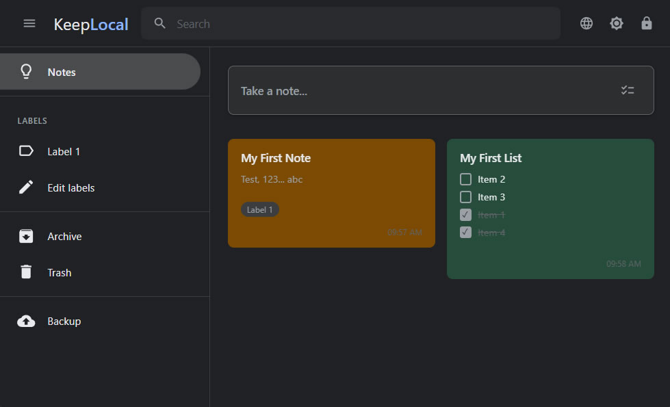

# 📝 KeepLocal — Secure Offline Notes

> 🇧🇷 [Leia em Português](README.pt-BR.md)

A Google Keep-inspired notes and task list SPA, 100% client-side with AES-256-GCM encryption. No data ever leaves your browser.



## ✨ Features

- **Text notes** with Markdown support (rendering + preview)
- **Task lists** with sub-items (1 level), drag & drop to reorder and move between pending/done
- **AES-256-GCM encryption** via Web Crypto API — each record individually encrypted in IndexedDB
- **100% offline** — no external requests, all dependencies are local
- **Themes** — dark and light
- **Colors** — 12 note colors inspired by Google Keep
- **Labels** for organization
- **Pin** to keep important notes on top
- **Archive** to store notes without deleting
- **Trash** with automatic purge after 7 days
- **Search** by title and content
- **Duplicate** notes
- **Undo/Redo** in editing modals (Ctrl+Z / Ctrl+Y)
- **Drag & drop** to reorder cards on the grid
- **Backup** — export/import encrypted data (JSON)
- **Secure session** — 5-minute idle timeout, key kept only in sessionStorage

## 🔐 Security

| Aspect | Implementation |
|---|---|
| Key derivation | PBKDF2 — 600,000 iterations, SHA-256 |
| Encryption | AES-256-GCM — random 12-byte IV per record |
| Storage | IndexedDB — only encrypted data persists |
| Session | CryptoKey exported as JWK in sessionStorage |
| Sanitization | DOMPurify applied to all Markdown output |
| Password | Minimum 8 characters, 1 uppercase, 1 special character |
| No recovery | No "forgot password" — no backdoors |

## 🚀 Getting Started

No build tools, bundlers, or dependency installation required. Just serve the files:

```bash
# With Python
python3 -m http.server 8080

# With Node.js
npx serve .

# Or any static HTTP server
```

Open `http://localhost:8080` and create your password on first use.

## 🧩 Chrome Extension

Also available as a Chrome Extension (Manifest V3):

```bash
# Build the package
./build-extension.sh

# Or load manually:
# 1. Open chrome://extensions
# 2. Enable "Developer mode"
# 3. Click "Load unpacked"
# 4. Select the chrome-extension/ folder
```

## 📁 Project Structure

```
keep_local/
├── index.html              # Entry point
├── css/
│   ├── variables.css       # Theme tokens (dark/light, colors)
│   ├── base.css            # Reset, typography, buttons
│   ├── auth.css            # Login/signup screen
│   ├── layout.css          # Sidebar, header, grid
│   ├── cards.css           # Note cards (masonry)
│   ├── modal.css           # Edit modals
│   └── components.css      # Checkbox, toast, tooltip
├── js/
│   ├── app.js              # Bootstrap, SPA router, views, modals
│   ├── auth.js             # Authentication, session, timer
│   ├── crypto.js           # PBKDF2, AES-256-GCM, import/export
│   ├── db.js               # IndexedDB wrapper
│   ├── backup.js           # Backup export/import
│   ├── theme.js            # Dark/light toggle
│   ├── history.js          # Undo/redo stack
│   ├── icons.js            # Inline SVG icons
│   └── utils.js            # UUID, debounce, formatDate, etc.
├── lib/
│   ├── marked.min.js       # Markdown parser (v15.0.12)
│   └── purify.min.js       # DOMPurify (v3.3.3)
├── chrome-extension/       # Chrome Extension package
│   ├── manifest.json       # Manifest V3
│   ├── service-worker.js   # Background script
│   ├── privacy.html        # Privacy policy
│   └── icons/              # Icons 16/48/128 PNG
└── docs/
    └── Prompt.txt          # Original project prompt
```

## 🛠️ Stack

- **HTML5** + **CSS** (native CSS Nesting) + **Vanilla JavaScript** (ES Modules)
- **Web Crypto API** — native browser cryptography
- **IndexedDB** — structured local storage
- **marked.js** — Markdown rendering
- **DOMPurify** — XSS sanitization
- **No frameworks, bundlers, or build dependencies**

## 📋 Browser Requirements

Modern browsers with support for:
- CSS Nesting
- Web Crypto API
- IndexedDB
- ES Modules

Chrome 120+, Firefox 117+, Edge 120+, Safari 17.2+

## 📄 License

[MIT](LICENSE)

## 📄 Licença

MIT

## Tests

Zero-dependency unit and Chromium regression tests: [tests/README.md](tests/README.md).

## Binary backup format and recovery

New exports use `.keeplocal`, MIME `application/octet-stream`, without magic,
plaintext app/version identifiers, JSON headers or KDF parameters:

| Byte offset | Length | Meaning |
|---|---|---|
| 0 | 16 | Raw PBKDF2 salt (the vault salt) |
| 16 | 12 | Random AES-GCM nonce |
| 28 | remainder, at least 16 | Ciphertext followed by the 16-byte GCM tag |

Recovery tools must try the immutable profiles in `js/backup-v2.js` in order.
Currently there is exactly one: **profile 2**, PBKDF2-HMAC-SHA-256, **600000**
iterations, UTF-8 password without normalization, AES-256-GCM, 128-bit tag.
Derive the key from the password and bytes `[0,16)`. The authenticated additional
data is exactly **29 bytes**: `[0x02] || salt[16] || iv[12]`. Decrypt bytes `[28,end)`
with nonce `[16,28)`. Decode the authenticated plaintext as UTF-8 JSON.
The payload contains `v:2`, `profile:2`, `rev`, ISO `exportedAt`, `preferences`
(`lang`, `theme`), `notes`, and `manifest:{count,ids}`. `ids` must equal note IDs
in their exact array order. Notes are the original encrypted IndexedDB records
`{id,iv,ciphertext,updatedAt}` (Base64 inner IV/ciphertext); decrypt each using the
same derived key and validate the note and its matching ID/timestamp. Keeping
inner records also preserves unreadable local records in an export; such a
backup requires recovery of those records before a complete import can succeed.
No plaintext record identifiers, timestamps, counts or per-note lengths are in
the outer envelope. Total ciphertext length and the salt remain observable;
exports from the same vault share a salt. A file is limited to 64 MiB, 10,000
notes and 2 MiB per serialized UTF-8 note. Profiles must enforce 600000–5000000
iterations **before** deriving; file bytes never select an arbitrary KDF cost.
Future profiles must preserve profile 2 and append a documented recovery path.

Legacy v1 JSON is still imported after complete validation and atomic replacement.
V1 cannot detect removal of a whole record. V2 authenticates the complete payload
and checks its manifest. Replacing an export with an older *valid* export remains
possible (rollback); revision/merge handling belongs to the blocked Phase 3.

`rev` is a safe integer persisted as `meta.exportRev` and incremented on every
export (first export: 1). `parent` is `null` for the first export, otherwise the
lowercase hexadecimal SHA-256 of the **exact UTF-8 JSON plaintext bytes** of the
previous export, before encryption (not the envelope, not the ciphertext).
`meta.exportParent` stores the current export's plaintext hash for the next one.
The counter and parent are committed together, with a compare-and-swap that
rejects concurrent export tips. A v2 import resumes its counter and records the
imported payload's exact hash as the next parent. These fields reserve lineage
only; they perform no merge, cloud write, rollback protection or synchronization.

Local libraries: Marked **18.2.1** (browser UMD bundle) and DOMPurify **3.4.18**.
Versions, upstream release review and download integrity are recorded in
[`lib/VENDOR.md`](lib/VENDOR.md); `lib/SHA256SUMS` is verified by the unit gate.
