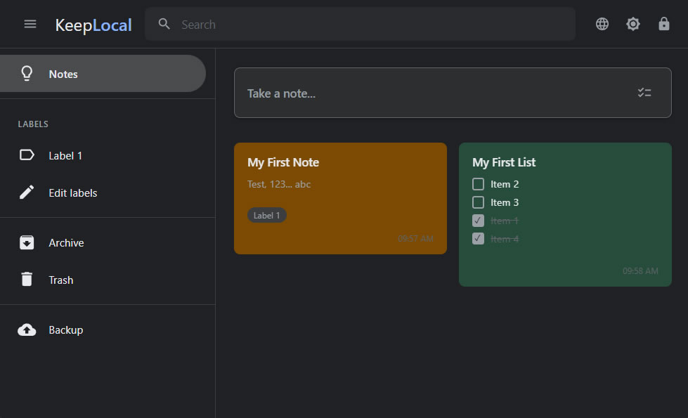

# KeepLocal — Notas Seguras Offline

[English](README.md)

Notas e listas de tarefas com criptografia local no navegador. O app funciona
sem servidor de dados, conta na nuvem, analytics ou dependências de runtime.
Exportar um backup e abrir links externos são ações explícitas do usuário.



## Recursos

Notas com prévia segura de Markdown, tarefas com um nível de subtarefas, cores,
rótulos, busca, fixação, arquivo, lixeira de 7 dias, duplicação e desfazer/refazer.
Novas notas aparecem no topo; arrastar move e normaliza a ordem. Listas vazias
ficam temporárias até conterem texto. Cor/rótulo são escolhidos após criar a nota,
no card ou editor; os botões inativos do rascunho foram removidos.

## Segurança

| Aspecto | Implementação |
|---|---|
| Chave | PBKDF2-HMAC-SHA-256, 600000 iterações, salt aleatório de 16 bytes |
| Cifra | AES-256-GCM, IV aleatório de 12 bytes e tag de 16 bytes |
| Verificação | Bloco conhecido cifrado (`keyCheck`); sem verificador rápido em cofres novos/migrados |
| Sessão | Chave não exportável somente em memória; recarregar exige senha; bloqueio após 5 min de inatividade |
| Senha nova | 14 caracteres no mínimo, sem composição obrigatória; lista embutida de senhas comuns e verificação de sequências/padrões; prefira 5+ palavras sorteadas |
| Disco | Notas cifradas no IndexedDB; preferências e metadados locais (salt, IDs externos, timestamps, estado de backup) não são secretos |
| Backup | Envelope binário v2 autenticado; JSON v1 somente na importação legada validada e atômica |
| Markdown | HTML bruto exibido como texto, imagens removidas, DOMPurify restritivo e CSP; falta de biblioteca resulta em texto simples |
| Abas | Identidade do cofre e versão da nota conferidas atomicamente; conflitos oferecem salvar como nova nota |
| Recuperação | Registros ilegíveis podem ser copiados quando decifráveis ou descartados após confirmação digitada e export obrigatório; não existe recuperação da senha |

O código do app pode acessar o texto enquanto o cofre está aberto. Quem altera os
scripts pode capturar senha e notas. **Sirva somente o código, separado da pasta
de backups/dados, e proteja-o contra escrita por terceiros.** Não coloque os
scripts numa pasta compartilhada gravável por outras pessoas. Proteja também o
perfil do navegador e o sistema operacional. A persistência de armazenamento é
solicitada uma vez e pode ser recusada; ela não substitui um backup externo.

## Executar

Sem npm, bundler ou instalação de pacotes do app. Num diretório que contenha
somente os arquivos de código:

```bash
python3 -m http.server 8080 --bind 127.0.0.1
```

Abra `http://127.0.0.1:8080`. Mantenha a mesma origem/porta para acessar o mesmo
IndexedDB. O servidor requer Python 3; Web Crypto requer contexto seguro (localhost
ou HTTPS). Desenvolvimento validado em Chromium; outros navegadores não foram
validados nesta execução. A extensão requer Chrome 120+.

## Backup e migração

1. Antes da atualização, exporte com a versão antiga e guarde fora da pasta do
   app e da pasta sincronizada. Nunca substitua sua única cópia de segurança.
2. Entre na versão nova: o verificador legado é migrado atomicamente. Senhas de
   contas antigas continuam aceitas; a política nova vale para criar/trocar senha.
3. Use **Trocar senha mestra**, com senha atual e uma nova frase longa aleatória.
4. Clique **Backup** para iniciar o download `.keeplocal`. Confira o arquivo:
   o app não confirma que o navegador o gravou. `lastBackupAt` registra a tentativa
   de download, e o aviso pendente acompanha alterações desde essa tentativa.
5. Guarde o arquivo em uma pasta de dados separada, sincronizada pelo seu serviço
   de preferência. **Não existe escrita automática no Mega ou sincronização pelo
   app** nesta fase. Merge e escrita automática pertencem à Fase 3, bloqueada.
6. Apague backups antigos, incluindo versões retidas na nuvem: continuam usando
   a senha antiga e os v1 podem conter o verificador rápido. Verifique seu backup
   novo antes de remover cópias necessárias para recuperação.

A aba Importar aceita v2 binário ou JSON v1, pede a senha do arquivo, valida tudo,
confirma quantas notas serão substituídas e grava numa transação. Cancelamento,
senha incorreta, modelo inválido e falha de gravação preservam o cofre anterior.
Registros locais ilegíveis ficam no banco, geram aviso e são preservados no export;
recupere-os antes de esperar uma importação integral desse backup.

## Extensão e testes

```bash
bash build-extension.sh
node --test tests/unit
CHROME_BIN=/caminho/chromium node tests/browser/run.mjs
```

O build lê a versão do manifest (atualmente 1.0.0), sincroniza as cópias versionadas
e gera `dist/keep_local_extension_v1.0.0.zip`. Para teste manual, use
`chrome://extensions` → Modo desenvolvedor → Carregar sem compactação →
`chrome-extension/`. O manifest mantém `permissions: []`.
[Instruções dos testes](tests/README.md). O runner usa apenas perfis descartáveis
com dados fictícios; `SKIP` por falta de Chromium não comprova os critérios visuais.

## Arquivos

- `index.html`, `css/`: entrada, CSP e estilos (tokens em `css/base.css`).
- `js/app.js`: telas e integração; `auth.js`, `session.js`, `lifecycle.js`: login,
  sessão em memória e descarte de callbacks.
- `js/crypto.js`, `db.js`, `note-model.js`, `edit-session.js`, `editor-limits.js`, `recovery.js`: cifra, transações,
  validação e fila de gravação/rascunho.
- `js/backup.js`, `backup-format.js`, `backup-v2.js`: importação, download e formato.
- `js/account.js`, `vault-events.js`, `trash.js`, `storage.js`: troca/reset,
  comunicação entre abas, retenção e persistência.
- `js/i18n.js`, `theme.js`, `history.js`, `icons.js`, `utils.js`: utilitários da UI.
- `lib/`: bibliotecas locais, hashes e procedência.
- `chrome-extension/`: manifest, service worker, privacidade, ícones, locales e
  cópias de `js/`, `css/`, `lib/`, `index.html` sincronizadas pelo build.
- `tests/unit/`, `tests/browser/`, `tests/fixtures/`: gate sem dependências npm.

## Formato binário do backup e recuperação

Exportações novas usam `.keeplocal`: `[salt 16 bytes][iv 12 bytes][ciphertext+tag]`,
sem magic, app, versão, parâmetros KDF ou cabeçalho JSON em claro. O perfil 2
(único atual, tentado primeiro) usa PBKDF2-HMAC-SHA-256, 600000 iterações, senha
UTF-8 sem normalização, chave AES-256-GCM e tag de 16 bytes no final. AAD =
`[0x02] || salt[16] || iv[12]` (29 bytes). O salt é o do cofre e se repete entre
exportações dele. O comprimento total do arquivo permanece observável.

Decifre os bytes a partir do offset 28 com o nonce do offset 16. O JSON UTF-8
cifrado contém `v:2`, `profile:2`, `rev`, `exportedAt`, `preferences`, `notes` e
`manifest:{count,ids}`. Os IDs devem corresponder à ordem exata do array de notas.
As notas são registros cifrados originais `{id,iv,ciphertext,updatedAt}`; IV e
ciphertext internos são Base64, decifrados com a mesma chave, e ID/timestamp
internos devem coincidir. Isso preserva registros ilegíveis na exportação; será
necessário recuperá-los para importar integralmente um backup que os contenha.
O README em inglês e `js/backup-v2.js` detalham o contrato para ferramentas futuras.
Perfis ficam no código em ordem conhecida, limitados a 600000–5000000 iterações
antes da derivação; nenhum byte do arquivo controla o custo do KDF. Limites:
64 MiB por arquivo, 10000 notas, 2 MiB por nota serializada em UTF-8.

JSON v1 continua importável, com aviso e substituição atômica. V1 não detecta
remoção de registros inteiros. V2 autentica o conjunto e confere o manifesto.
Uma cópia antiga válida continua aceita (rollback); revisão/merge pertencem à
Fase 3, bloqueada.

`rev` é inteiro seguro persistido em `meta.exportRev`, incrementado a cada
exportação (primeira: 1). `parent` começa `null`; depois é o SHA-256 hexadecimal
minúsculo dos **bytes UTF-8 exatos do JSON em claro** da exportação anterior,
antes de cifrar (não do envelope). `meta.exportParent` guarda o hash do payload
atual para a próxima. Contador e hash são gravados juntos, recusando pontas
concorrentes. Importar v2 retoma seu contador e usa o hash exato do payload
importado como próximo pai. São campos de linhagem reservados: não há merge,
sincronização, escrita em nuvem nem proteção contra rollback nesta fase.

Bibliotecas locais: Marked **18.2.1** (bundle UMD) e DOMPurify **3.4.18**.
Procedência, revisão das versões e integridade em [`lib/VENDOR.md`](lib/VENDOR.md).
O gate de unidade confere `lib/SHA256SUMS`.

## Licença

[MIT](LICENSE)

## Registros ilegíveis e antigos

O aviso persistente abre **Recuperação somente leitura**. Ele distingue falha de
cifra, JSON inválido, modelo/limites incompatíveis e notas antigas acima do limite.
Dados decifráveis aparecem somente para leitura; nada é alterado ou apagado.
Bloquear limpa essa tela. Limites de edição/importação: título 4096 caracteres,
texto de tarefa 65536, rótulo 200, 100 rótulos e 10000 tarefas por nota, além dos
2 MiB da nota serializada em UTF-8. Registros cifrados existentes acima desses
limites ou com IV/dados danificados continuam intactos nos arquivos v2, dentro
dos 64 MiB/10000 registros por arquivo. Decodificar o envelope preserva esses
registros para recuperação; **importar** valida tudo estritamente e rejeita o
conjunto sem alterar o banco. Repare dados antigos antes de reimportar ou trocar
a senha. Bloqueio automático limpa texto não salvo; falha no bloqueio manual
oferece cancelar ou descartar explicitamente. Exportação em andamento é cancelada
se a sessão terminar ou mudar.

## Recuperação de registros ilegíveis

O export avisa antes quando houver registros ilegíveis e informa que o arquivo
não pode ser restaurado integralmente nesse estado. A Recuperação permite criar
uma nota válida contendo o texto bruto decifrado; conteúdo acima do limite fica
somente para leitura e cópia manual. O descarte tem dois passos: Exportar agora preserva o registro sem excluir;
depois confira o arquivo salvo, marque a confirmação explícita e digite DESCARTAR.
O app não confirma gravação no disco. O comprovante fica somente nesta sessão e
qualquer alteração do snapshot do cofre exige novo export. O snapshot completo
é conferido novamente na transação de exclusão, incluindo outros registros. Depois de resolver todos os registros
ilegíveis, importação integral e troca de senha voltam a funcionar. O indicador
de força de senha é uma heurística; ele não mede a aleatoriedade das palavras.
